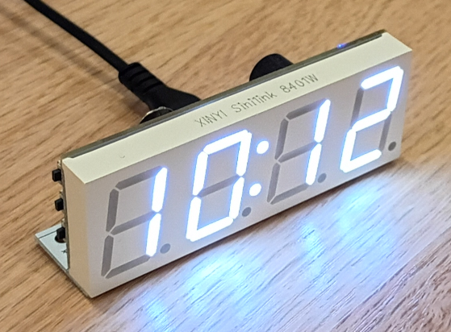
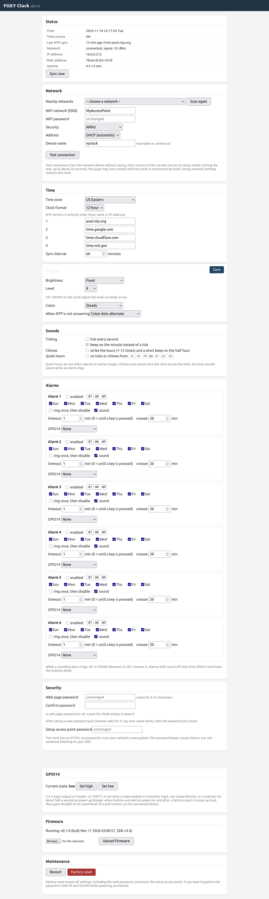

# FOXY Clock: Open Firmware for the Sinilink XY-Clock

**FOXY Clock** is replacement firmware for the Sinilink XY-Clock, low-cost WiFi digital clock built
around an ESP8285. This firmware is built with the [ESP8266 RTOS SDK](https://github.com/espressif/ESP8266_RTOS_SDK) v3.4.

Features include:

- Automatic NTP time synchronization
- Web interface with password protection
- **NO phone app, NO cloud**, fully in your control
- 12/24-hour display
- Adjustable fixed or day/night brightness
- 6 alarms with snooze, day-of-week, automatic timeout
- Firmware updates through the web UI (after initial serial flash)
- Hourly chimes, ticking, quiet hours
- Up to four NTP servers with failover
- Automatic daylight savings
- Alarm controlled digital output for external device control

## Documentation

1. [Installation](docs/INSTALLATION.md)
2. [User manual](docs/USER_MANUAL.md)
3. [Hardware](docs/HARDWARE.md)
4. [Development](docs/DEVELOPMENT.md)

## Quick start

1. Flash the firmware ([Installation](docs/INSTALLATION.md)).
2. Join WiFi `XYClock-XXXX` (password `xyclock123`) and open [http://192.168.4.1](http://192.168.4.1).
3. Enter WiFi network details, time zone, and a password, then save.

## Web UI Screenshot

## Related Projects

There are several related projects, including other custom firmware for the Sinilink XY-Clock or similar clocks, or various levels of documentation and reverse engineering.

- [EdenRidgway/XY-Wifi-Clock](https://github.com/EdenRidgway/XY-Wifi-Clock): Arduino based replacement firmware.
- [Utyff/xy-clock](https://github.com/Utyff/xy-clock) Another Arduino firmware, based off the project.
- [/maarten-pennings/303WIFILC01](https://github.com/maarten-pennings/303WIFILC01), custom firmware for the similar 303 WIFI LC 01 clock.
- [trip5/EspHome-Led-Clock](https://github.com/trip5/EspHome-Led-Clock) Firmware for use with [ESPHome](https://esphome.io/).
- [Tasmota](https://templates.blakadder.com/XY-Clock.html) firmware and [discussion](https://github.com/arendst/Tasmota/discussions/15788).